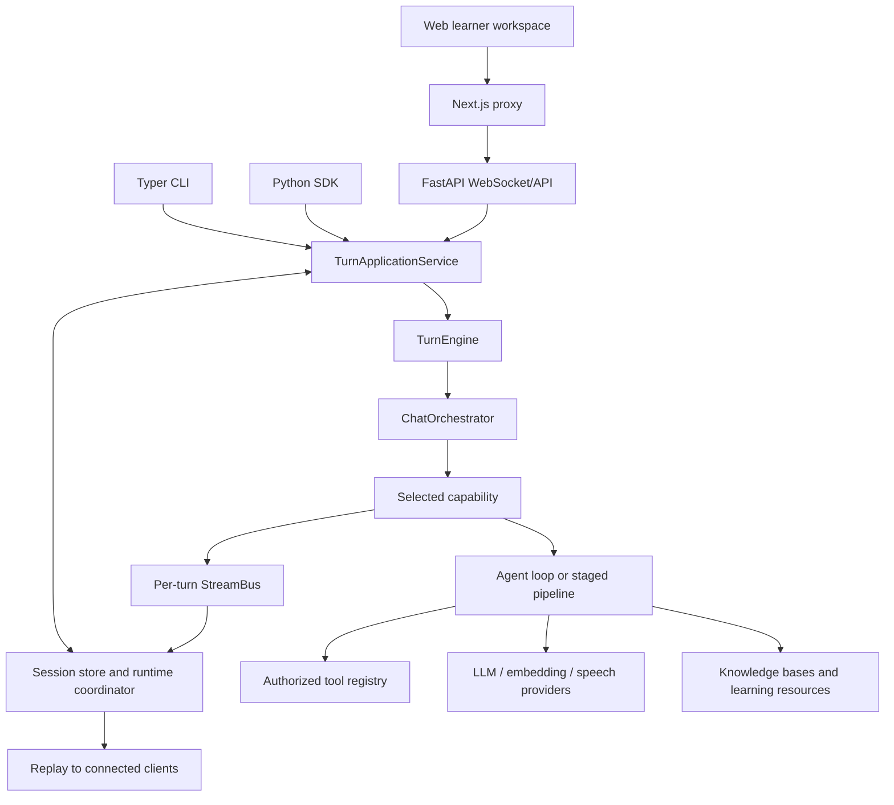

Failed to create stream fd: Operation not permitted
Failed to create stream fd: Operation not permitted
Failed to create stream fd: Operation not permitted
# Architecture

This document describes the checked-out DeepTutor `v1.7.3` baseline and the product direction in `../AI_Teacher_DeepTutor_Analysis_and_Role_Plan.pdf`. The PDF analyzed `v1.6.15`; confirm version-specific details in the checked-out source before changing behavior.

## High-level design and data flow

DeepTutor is an agent-native learning workspace. CLI, WebSocket, and Python SDK entry points share one durable turn application service. It records turn state, routes work through a turn engine and orchestrator to a capability, mounts authorized tools, and streams/persists events for adapter replay.

Tools are individual operations selected during a turn. Capabilities own an entire turn and may use a shared chat loop or a multi-stage pipeline. The module system declares package ownership, dependencies, capabilities, routers, CLI groups, navigation, and lifecycle hooks. A third-party plugin is distinct from an official feature module.

## API routing

The backend is FastAPI under `deeptutor/api/`. Routers are assembled by `RouterLoader` and module manifests, rather than all endpoints being registered in one static file. The Next.js App Router lives in `web/app/`; `web/proxy.ts` forwards `/api/*` and `/ws/*` requests to the configured backend. `web/contracts/` contains generated API and turn-protocol contracts.

Important route areas include:

| Area | Source | Examples of responsibilities |
| --- | --- | --- |
| Unified turns | `deeptutor/api/routers/unified_ws.py` | Streamed chat and capability turns |
| Sessions | `deeptutor/api/routers/sessions.py` | Conversation/session operations |
| Authentication and users | `deeptutor/api/routers/auth.py`, `multi_user.py` | Local auth, users, roles and grants |
| Knowledge | `deeptutor/api/routers/knowledge.py` | Knowledge-base configuration and retrieval operations |
| Guided learning | `deeptutor/api/routers/mastery_path.py`, `practice.py`, `question.py` | Mastery paths, practice and questions |
| Reading and books | `deeptutor/api/routers/reading.py`, `book.py` | Source-grounded reading and book workflows |
| Settings and tools | `settings.py`, `tools.py`, `capabilities.py` | Runtime configuration and capability/tool surfaces |

Exact paths and request/response schemas are defined by the router decorators and exported contracts. Treat `web/contracts/schema/openapi.json` and `turn-protocol.json` as generated artifacts; update them through the repository's contract workflow when API models change.

## Persistence and data model

The default runtime home contains both SQLite databases and ordinary files. It is a local persistence layout, not a normalized multi-tenant SaaS database schema.

| Store | Contents |
| --- | --- |
| `data/user/chat_history.db` | Sessions, messages, turns, question-bank entries, and practice data |
| `data/user/.runtime/workspaces.sqlite3` | Workspace runtime metadata |
| `data/user/settings/` | JSON/YAML runtime settings and configured provider data |
| `data/system/` | Local accounts, grants, audit records, indexes, owner credentials |
| `data/knowledge_bases/` | Knowledge-base sources, indexes, and versioned artifacts |
| Workspace `.deeptutor/data/` | Private learning records for an external Content Workspace |
| Other runtime paths | Logs, parse caches, generated artifacts, imported documents, partner/user workspace data |

SQLite is the supported local backend. Optional PocketBase integration stores supported session collections but does not move all state and is single-user. There is no supported PostgreSQL/MySQL adapter. Backups should include the entire runtime home plus separately located workspaces and be taken with writers stopped. See [`docs-for-dev/DATA_STORAGE.md`](docs-for-dev/DATA_STORAGE.md) before changing stores, migrations, or workspace ownership.

## Core technical decisions

- **One durable turn path:** entry points use `TurnApplicationService` so persistence, replay, cancellation, and recovery stay consistent.
- **Capability/tool separation:** capabilities own turn-level workflows; tools expose individual operations with context and policy gates.
- **Modular features:** official modules declare ownership and dependencies; avoid creating new cross-module cycles.
- **Runtime home isolation:** runtime settings live under `data/user/settings/`; `.env` is not general app configuration.
- **Source-grounded learning:** retrieval engines are selectable per knowledge base; citations and versioned indexes support traceability.
- **Browser/server boundary:** deployment addresses and secrets remain server-side; the Next.js proxy mediates backend requests.

## Intended AI Teacher product layer

The PDF proposes a SaaS shell and curriculum layer around a mostly untouched, pinned engine: learner experience, teacher/parent view, auth and roles, classrooms, plan/quota enforcement, safety filters, analytics, curriculum content, hint pedagogy, assessments, evaluation sets, and localization. This is a proposed architecture; these pieces should not be described as implemented until they are present in this repository.

For the first milestone, keep scope to one selected learner group, subject/level, curriculum, language, and a diagnostic → tutored practice → progress report journey. Enforce authorization, usage limits, and any eventual tenant isolation on the server. Do not expose student access to administrative tools, subprocess execution, or privileged integrations by default. Keep an inherited-versus-new implementation ledger and avoid unreviewed upstream merges.
